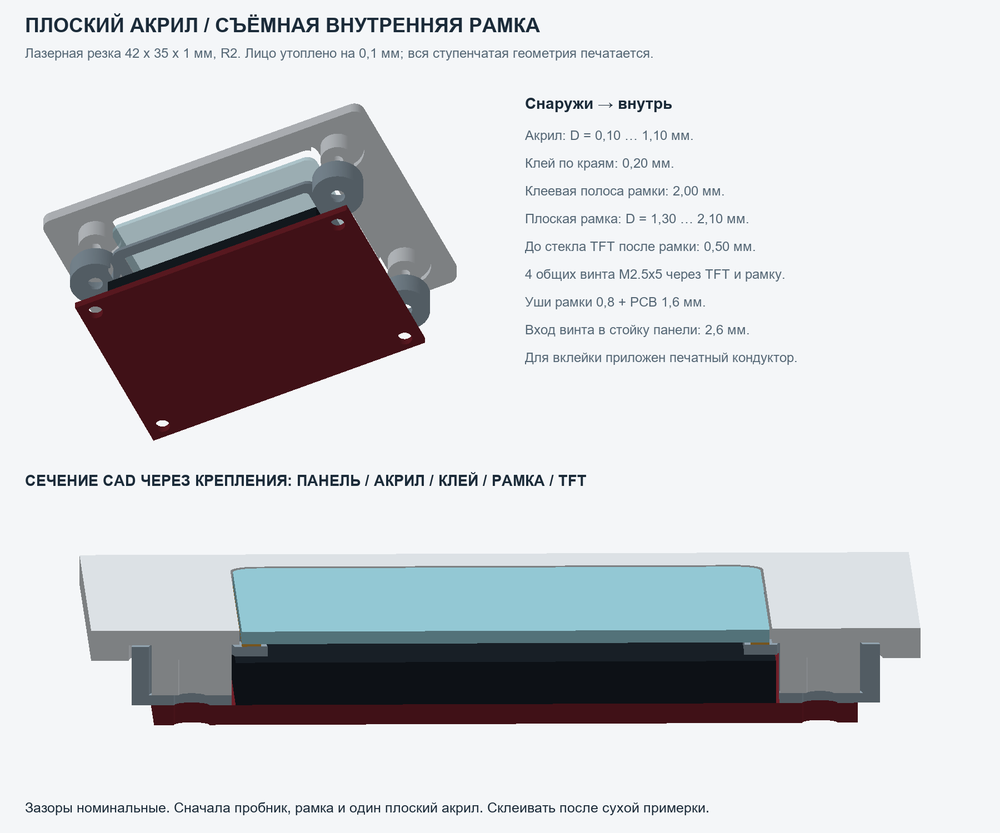
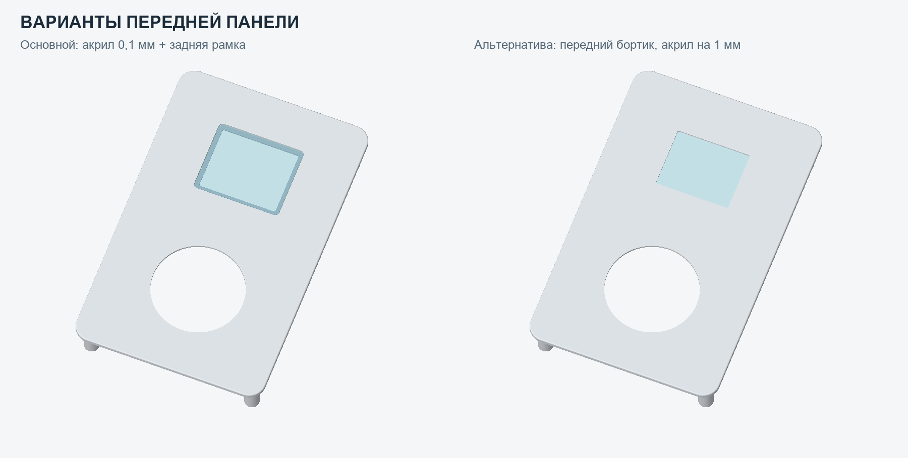

# Плоский акрил почти заподлицо: задняя клеевая рамка

Основной вариант v0.4 использует **обычный плоский кусок акрила 42×35×1 мм, R2**. Для него нужен только лазерный вырез по замкнутому контуру. Уступов или выборок на акриле нет. Все объёмные элементы напечатаны в передней панели и отдельной рамке.

| Элемент | Номинальная глубина D от лица корпуса, мм |
|---|---:|
| Лицо акрила | 0.10 |
| Задняя поверхность акрила | 1.10 |
| Клеевой шов | 1.10…1.30, толщина 0.20 |
| Плоская клеевая рамка | 1.30…2.10, толщина 0.80 |
| Стекло TFT, передняя поверхность | 2.60 |
| Опора ушей рамки на стойках панели | 5.20 |
| Опора платы TFT на задних ушах рамки | 6.00 |
| PCB TFT | 6.00…7.60 |

Рамка выступает под акрил по **2 мм** с каждой стороны, её внутреннее окно **38×31**. Номинальная зона клея отступает от внутренней кромки на 0.5, чтобы клей не выдавился в оптическое поле. Клей соединяет акрил с рамкой, а рамка держится четырьмя винтами. Само стекло TFT механической опорой не является. Воздушный зазор от рамки до стекла **0.5**, от акрила до стекла **1.5** по текущим оценочным размерам TFT.

В передней панели сквозной проём **42.4×35.4**, зазор по 0.20 на сторону. По краям сзади выбраны места для четырёх чашек рамки, проходящих вокруг стоек. Уши рамки 0.8 и PCB 1.6 стягиваются общими **M2.5×5**. Вместо прежних x4 в этом варианте нужны именно x5; резерв перед дном пилота 0.25.

## Пробник и вклейка

1. Напечатать **acrylic_seat_coupon** и **display_lens_carrier**, вырезать один акрил, удалить заусенцы. Проверить ваш TFT, отверстия и высоту стекла. Рамка должна садиться на стойки, акрил свободно проходить в проём. Ни акрил, ни рамка не должны прижимать стекло.
2. При необходимости подобрать зазор проёма вариантами acrylic_seat_gap_0p15/0p25/0p30. Для всех используется один и тот же плоский акрил. Изменить параметры и перегенерировать основную панель после выбора.
3. Напечатать **lens_gluing_jig**. Слой 0.10, измерить реальный выступ центральной площадки. Она должна быть выше окружающей опоры на 0.1. Наружная плоскость панели опирается на рамочный бортик кондуктора, лицо акрила — на его центральную площадку. Так задаётся небольшой отступ акрила от лица панели.
4. Проверить выбранный клей на обрезках акрила и материала печати. Использовать состав с подтверждённой совместимостью с PMMA и вашим филаментом. Закрыть кондуктор тонким разделительным слоем, одинаковым на обеих опорных поверхностях; он не должен приклеиться к изделию.
5. Снять TFT. Положить панель лицом на кондуктор, вложить акрил лицом на центральную площадку. Его наружная защитная плёнка/подкладка не должна незаметно менять выставляемые 0.1: проверить уровни насухо.
6. Нанести клей тонкой полосой на плоский 2-мм периметр **display_lens_carrier**, выдерживая отступ от внутреннего окна. Установить рамку сзади. Для фиксации без дисплея использовать **4×M2.5×3** через уши рамки в стойки панели: вход в пилот 2.2, запас 0.65. Рамку прижать к стойкам, не прогибая её и акрил. Номинальный зазор под клей при этом 0.2.
7. Дождаться отверждения по инструкции клея. Снять кондуктор, проверить чистоту и уровень окна. Затем поставить PCB TFT на рамку и заменить временные x3 на **M2.5×5**. Они проходят PCB 1.6 и рамку 0.8, входят в пластик на 2.6. Проверить отсутствие контакта рамки/стекла.

Короткие кольцевые мосты печатной рамки около 2 мм проверить слайсером. Клеевая сторона рамки печатается плоско на столе; выступающих восьми клеевых упоров в этом варианте нет. Уровень при вклейке задают кондуктор и посадка рамки на стойках. Физическая печать/клей/прочность ещё не испытывались.

## Лазерные файлы

- **laser/acrylic_screen_lens_1to1.dxf**: миллиметры, один замкнутый контур CUT с настоящими круговыми дугами.
- **laser/acrylic_screen_lens_1to1.svg**: физический размер 42 mm × 35 mm, одна замкнутая линия, без текста и заливки.
- **laser/acrylic_stock_layout_1to1.dxf/svg**: 8 вставок, 4×2, на листе 200×100. Отступ 5, промежуток 3; граница листа не включена в резку.

Контуры совпадают с предыдущей версией. **Компенсация пропила не заложена**, её задают в CAM по реальному резу станка. Импортировать в мм/100%, без подгонки под лист. Сначала одна вставка и пробник, после проверки — общая раскладка.

## Альтернативная передняя панель

**front_panel_rear_lip_alternative.stl/step** сохраняет передний бортик 0.8 и старую вклейку акрила на глубине 1.0, с восемью упорами клеевого слоя 0.2. Здесь **display_lens_carrier не нужен**, дисплей прикручивается прежними **M2.5×4**, лазерная вставка остаётся 42×35×1. Поддон и колесо совместимы с обеими панелями. Исходный профиль — source/parameters_rear_lip.json.

