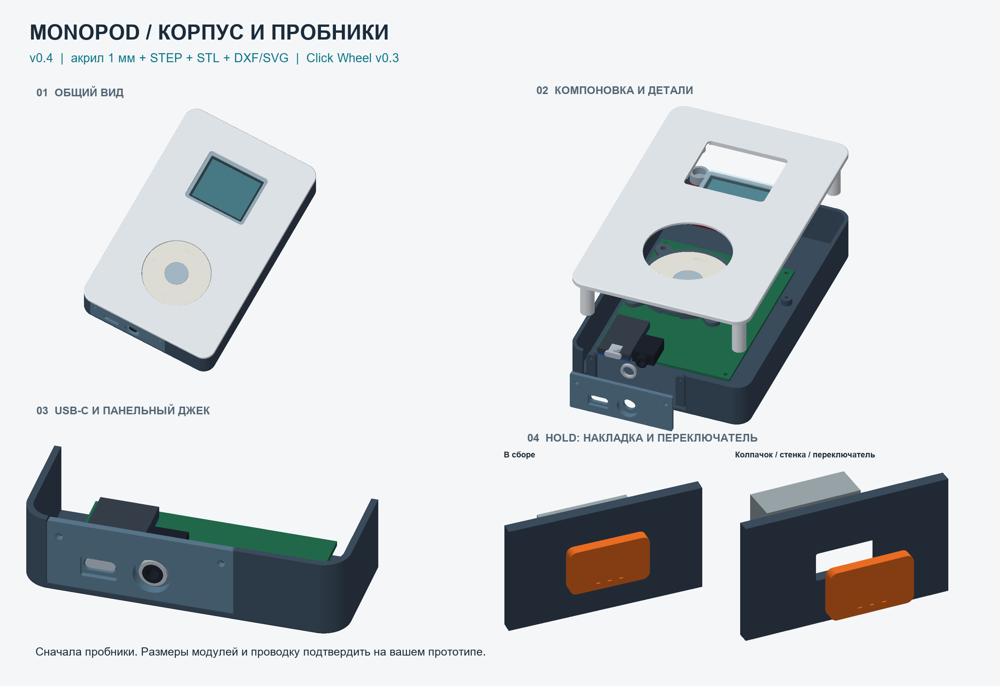
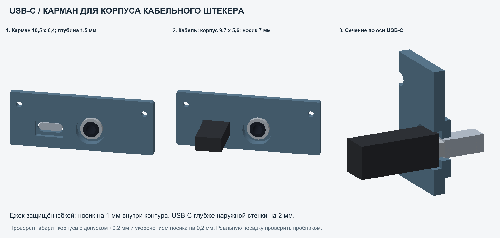
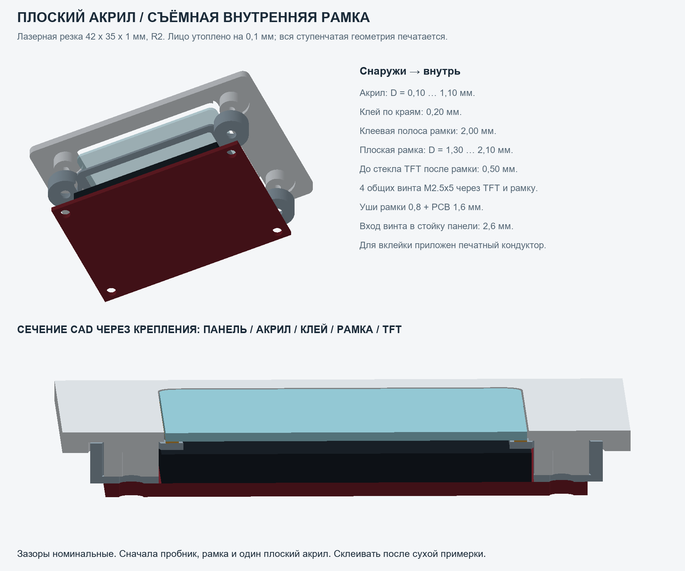

# MonoPod Enclosure v0.4 — USB-C и плоский акрил

02.11.2026. Новая версия сохраняет жёсткую припаянную сборку на макетке 70×90 и корпус 94×148×26. Изменены нижняя вставка и положение всей платы; добавлена передняя панель с плоским акрилом почти заподлицо и отдельная внутренняя рамка. Предыдущий v0.3 и его архив сохранены.



## Нижняя вставка

У миниджека сохранена защитная юбка/углубление. Конец резьбового носика теперь находится **на 1 мм внутри наружного контура**, гайка тоже утоплена. Расположение всей припаянной платы задаётся этим размером (`mainboard.jack_tip_recess`). При разнице вылетов 7.5 и 6.5 USB-C получается утопленным на **2 мм**.

Вставка имеет два уровня: широкий карман для корпуса кабельного штекера и небольшое сквозное окно под его металл/розетку USB-C. Ваши размеры корпуса **9.7×5.6**, носика **около 7** использованы как примерный обмер. Базовый карман **10.5×6.4**, глубина **1.5**, радиус углов 0.6, зазор **0.4 на сторону**. За дном кармана остаётся стенка 1.6; до платы зарядки номинально 0.4. Малое отверстие 9.6×3.8.



При условной глубине сопряжения металла **6 мм** корпус кабеля входит в карман на 1 мм и не упирается в его дно: остаётся 0.5 по оси. Эта глубина сопряжения **не измерена**; внутренние контакты USB не моделируются. Полное подключение проверяется вашим кабелем на пробнике.

В проверке размер корпуса дополнительно увеличен на **0.2 по полному размеру** обеих осей, носик укорочен на **0.2**. Это запас модели под примерный обмер и печать; он не является измерением погрешности штангенциркуля. Варианты **usb_cable_well_gap_0p30/0p50** дают 0.3/0.5 на сторону. Основная вставка — 0.4.

Макетка и разъёмы переместились вместе на **1.25 мм внутрь по Y** относительно v0.3. Поэтому для нового положения платы нужен новый **back_chassis** либо новый нижний пробник; не смешивать новую вставку со старым расположением опор. Прижимов отдельного зарядного модуля нет. Вставка крепится 2×M2×4, макетка 3×M2×5.

## Экран: плоская лазерная деталь и внутренняя рамка

Основной **front_panel** имеет сквозной проём **42.4×35.4**. Плоская вставка **42×35×1, R2** располагается лицом на глубине **0.1** от наружной панели. На заднюю сторону акрила приклеивается **display_lens_carrier** по полосе шириной **2 мм**. Рамка и PCB дисплея зажимаются **общими четырьмя M2.5×5** на стойках передней панели.



Акрил не имеет уступов, гравировки, карманов, отверстий или фрезерованных кромок. **Лазер режет один плоский замкнутый контур.** Ступени, посадки и крепёж находятся в печатном пластике. Контур акрила совпадает с v0.3; если вставка уже вырезана, её можно использовать после проверки фактических размеров.

Номинальный стек: акрил D0.1…1.1, клей D1.1…1.3, рамка D1.3…2.1, стекло TFT начинается с D2.6. До TFT после рамки остаётся **0.5 мм**; рамка опирается на стойки, а не на стекло. Окно в рамке 38×31 в сборочной ориентации. Старые параметры TFT ещё требуют примерки.

Для удобства вклейки есть **lens_gluing_jig**: плоская опора под лицо панели с центральной площадкой высотой 0.1 под акрил. Рамку можно временно закрепить **M2.5×3 без дисплея**, дождаться отверждения, затем поставить TFT и заменить винты на M2.5×5. Полная последовательность в [ACRYLIC_RU.md](ACRYLIC_RU.md).

Дополнительно дана **front_panel_rear_lip_alternative**: прежний передний пластиковый бортик с акрилом на глубине 1 мм. В этом варианте рамка **не устанавливается**, дисплей крепится M2.5×4. Лазерный акрил тот же. Источник альтернативы: `source/parameters_rear_lip.json`.

## Что печатать сначала

1. **bottom_edge_coupon + bottom_connector_insert**. Примерить всю припаянную плату, гайку и оба кабеля; верх платы поддержать на той же высоте. Проверить полное подключение и удержание USB. При тесном кармане сравнить **usb_cable_well_gap_0p50**, при свободном — 0p30.
2. **acrylic_seat_coupon + display_lens_carrier**, один вырезанный акрил и ваш TFT. Клей пока не наносить. Проверить проём, стойки, общие винты, отсутствие давления на стекло и внешний уровень акрила. Есть acrylic_seat_gap_0p15/0p25/0p30; базовый 0.20 на сторону.
3. **lens_gluing_jig** после выбора посадки. Площадка 0.1 мм требует проверки профиля печати, при необходимости отрегулировать `acrylic.face_recess`.
4. **mainboard_hole_template_coupon**, **stack_height_gauge**, **screw_boss_coupon**, пробники HOLD/Click Wheel. Высота сборки от нижней пайки до лица колеса остаётся **22 мм**. Три отверстия макетки по-прежнему условные: не сверлить готовую плату по этому шаблону.

Варианты **bottom_insert_recess_1p50/2p50** требуют сдвинуть **всю макетку** на −0.5/+0.5 по Y относительно базы. Её крепёжные опоры тоже нужно перегенерировать. Изменение в source — `mainboard.jack_tip_recess` (0.5/1.5 для этих вариантов). Оси припаянных разъёмов отдельно не перемещать.

**bottom_aperture_extra_0p20/0p40** увеличивают полный размер USB-кармана и малого окна, а также отверстие джека на 0.2/0.4; это свободные пробные окна. Варианты bottom_insert_gap меняют края вставки к одному базовому поддону, сохраняя оси/крепёж.

## Печать и сборка

FDM, сопло 0.4, масштаб **100%**, мм, без зеркалирования. Печатные STL ориентированы на стол: панель лицом вниз, поддон наружным дном вниз, рамка плоской клеевой стороной вниз, нижняя вставка наружной плоскостью вниз. Рамка и её уши 0.8; короткие мосты над чашками около 2 мм проверить в слайсере. У вставки проверить переходы кармана и углубления гайки, у поддона — горизонтальные пилоты/HOLD. Для кондуктора шаг слоя 0.10; физический результат высоты 0.1 измерить.

| Узел | Винты | Вход в пластик / пилот / запас конца, мм |
|---|---|---|
| Макетка | 3×M2×5 | 3.4 / Ø1.7×3.7 / 0.3 |
| Нижняя вставка | 2×M2×4 | 2.0 / Ø1.7×2.3 / 0.3 |
| TFT + новая рамка | 4×M2.5×5 | 5−1.6−0.8 = 2.6 / Ø2.1×2.85 / 0.25 |
| Только рамка при вклейке | временно 4×M2.5×3 | 3−0.8 = 2.2 / Ø2.1×2.85 / 0.65 |
| TFT в альтернативе с бортиком | 4×M2.5×4 | 2.4 / Ø2.1×2.65 / 0.25 |
| Click Wheel → панель | 4×M2.5×4 | 1.6 / Ø2.1×1.85 / 0.25 |
| HOLD | 2×M2×4 | 3.5 / Ø1.7×3.7 / 0.2 |
| Половинки | 4×M2.5×8 | 6.0 / Ø2.1×6.3 / 0.3 |

Сначала снять нижнюю вставку и гайку, опустить всю припаянную плату в открытый поддон, закрепить её, затем надеть вставку снаружи на разъёмы и установить гайку без изгиба пайки. Передняя панель ставится после укладки проводов. Не стягивать половинки через препятствия. Головки винтов и прочность резьбы в пластике проверить физически.

## Файлы и генерация

51 печатаемая деталь: **5 основных, 1 альтернативная панель, 45 пробников/вариантов**. Каждая имеет STEP и STL. Сборки: assembly_mockup, front_with_clickwheel, back_with_connectors, front_acrylic_display_assembly, acrylic_carrier_subassembly, bottom_cable_fit_assembly, soldered_electronics_assembly. Обзорный coupons_identification_sheet не печатают целиком.

Контуры лазера: [DXF одной вставки](laser/acrylic_screen_lens_1to1.dxf), [SVG](laser/acrylic_screen_lens_1to1.svg). В laser/ также раскладка 8 штук на 200×100. Импорт в мм, 1:1; контуры номинальные, компенсацию пропила задаёт оператор в CAM. Граница листа не является линией резки.

Основные параметры: **source/parameters.json**, все статусы в PARAMETERS_RU.md/CSV. X вправо, Y вверх, глубина D=−Z от лица корпуса. Параметры колеса v0.3 и оригинальные STEP не изменены. Габариты корпуса, TFT/Click Wheel и 22-мм стек сохранены; внутренние отверстия/высоты по месту уточняются пробниками.

Из папки комплекта, Python 3.12:

```powershell
py -3.12 -m venv .venv
.\.venv\Scripts\python.exe -m pip install -r source\requirements.txt
.\.venv\Scripts\python.exe source\build_enclosure.py
.\.venv\Scripts\python.exe source\verify_design.py
.\.venv\Scripts\python.exe source\make_laser_files.py
.\.venv\Scripts\python.exe source\make_parameter_table.py
.\.venv\Scripts\python.exe source\make_images.py
```

Сохранять отдельную копию перед генерацией: совпадающие экспорты перезаписываются. Альтернативный JSON предназначен для генератора CAD: указать `--parameters source/parameters_rear_lip.json --output отдельная_папка`. Готовая альтернативная панель уже лежит в cad/stl, вся остальная механика основного комплекта совместима. Рендерер основного комплекта показывает новую рамку. На этом ПК среда восстановлена отдельно в I:\DIY_iPod_Mono\CAD_Runtime_Enclosure_v04\venv; проект от этого пути не зависит.

## Проверки и границы результата

Все **51 BRep**, STEP после повторного чтения и замкнутые STL прошли проверки, включая габариты, объёмы и ориентацию. В номинальной сборке нет непредусмотренных пересечений. Проверены рамка со стойками/стеклом/акрилом, кабельный корпус с запасом размеров, пути опускания платы и выборочные положения надевания вставки/кабеля. 30 проверок перестраивают реальные тела при изменении параметров и отклоняют конфликтующие стеки. Параметры/скрипты и исходные референсы связаны SHA; прежний v0.3 проверяется неизменным перед упаковкой.

**Физическая примерка ещё не проведена.** Реальная глубина соединения USB, погрешность измерений, высоты осей разъёмов, толщина и отверстия макетки, TFT/HOLD/гайка, аккумулятор/проводка, печать и клей требуют проверки. Нижняя сборка проверена с консервативными непрерывными объёмами опускания; надевание вставки и кабеля — выборочные CAD-положения. Проверка не доказывает электрический контакт или прочность. Результаты: validation/geometry_check.json, parameter_variants.json, verification_summary.json.
