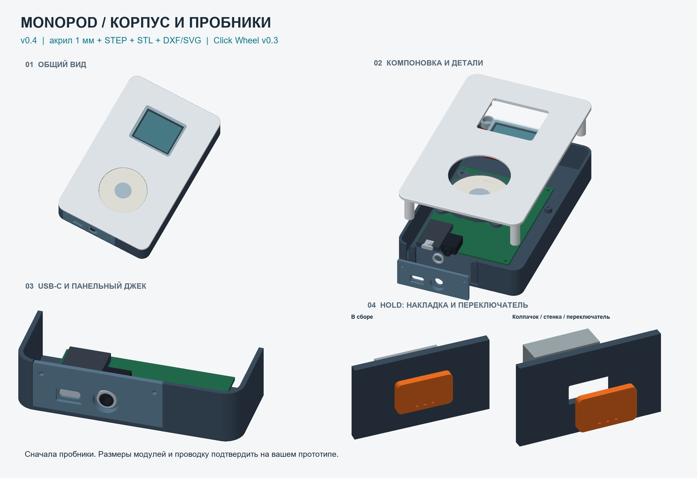

# Корпус MonoPod v0.4

Рабочая 3D-модель корпуса с нижней вставкой под USB-C и плоским акриловым окном дисплея.

**С чего начать:**

1. Посмотрите [подробные размеры и порядок сборки](TECHNICAL_NOTES_RU.md).
2. Для печати основных деталей откройте [`stl/`](stl/), для редактирования геометрии — [`source/`](source/) и [`cad/`](cad/).
3. Для лазерной резки акрила используйте [`laser/`](laser/) в масштабе 1:1 (мм).
4. Перед изготовлением полного комплекта напечатайте тестовые образцы посадок из `stl/` и проверьте собственные модули.

Размер корпуса по документации комплекта: **94 × 148 × 26 мм**. Варианты зазоров и высот — отдельные файлы, а не «более новые» релизы.

Это геометрия прототипа, а не гарантия совместимости с любым модулем ESP32-S3 и конкретными разъёмами.
